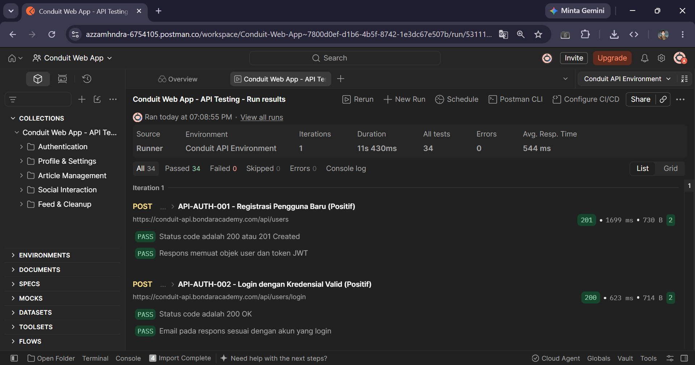

# 🔌 API Testing — Conduit REST API (`Postman`)

-orange)

## Ringkasan Pengujian API

Direktori ini mendokumentasikan pengujian otomatis lapisan **REST API** untuk aplikasi web **Conduit** menggunakan **Postman** (*Collection Runner* & skrip asersi JavaScript `pm.test`). Pengujian dirancang untuk memvalidasi kontrak skema JSON, status kode HTTP, autentikasi berbasis token JWT, skenario negatif (*error handling*), batas karakter input (*boundary*), serta pembersihan artikel dan komentar uji. API tidak menyediakan penghapusan akun, sehingga akun yang dibuat saat registrasi tidak dibersihkan otomatis.

---

## Konfigurasi & Artefak

| Komponen | Keterangan |
| :--- | :--- |
| **Default Base URL (lokal)** | `http://localhost:3000/api` |
| **Postman Collection** | [`Conduit_API_Collection.json`](./Conduit_API_Collection.json) (`Conduit Web App - API Testing`) |
| **Postman Environment** | [`Conduit_Environment.json`](./Conduit_Environment.json) (`Conduit API Environment`) |
| **Bukti Eksekusi Runner** | [`Postman_Runner_Result.png`](./Postman_Runner_Result.png) |

### Variabel Environment Dinamis
- `baseUrl`: Endpoint API; default mengarah ke layanan lokal.
- `allowHostedWrites`: Default `false`. Koleksi memblokir request `POST`, `PUT`, `PATCH`, dan `DELETE` ke hosted API kecuali flag ini diubah menjadi `true`.
- `user_username` & `user_email`: Dihasilkan secara unik pada tahap *Pre-request Script* (`qa_api_<timestamp>`) untuk mengurangi konflik duplikasi. Akun registrasi tidak dapat dihapus melalui API, jadi hindari menjalankan registrasi berulang kali pada hosted API.
- `user_password`: Isi hanya dengan password akun uji sekali pakai; jangan gunakan password pribadi atau kredensial produksi.
- `auth_token`: Token JWT yang diekstrak otomatis dari respons registrasi/login dan disisipkan ke header `Authorization: Token {{auth_token}}`.
- `article_slug` & `comment_id`: ID dinamis yang diteruskan antar-request untuk alur CRUD artikel, interaksi sosial, hingga penghapusan data uji (*cleanup*).

Untuk memakai hosted API, ubah `baseUrl` ke `https://conduit-api.bondaracademy.com/api` dan set `allowHostedWrites` ke `true` hanya jika memiliki izin. Request tulis membuat atau mengubah data pada layanan bersama.

---

## Cakupan Skenario Pengujian (19 Requests / 34 Assertions)

| Modul | ID Skenario | Method & Endpoint | Tipe Uji | Validasi Utama (`pm.test`) | Status |
| :--- | :--- | :--- | :---: | :--- | :---: |
| **Authentication** | `API-AUTH-001` | `POST /users` | Positif | Status `200`/`201`, objek `user` & simpan `auth_token` | ✅ Pass |
| **Authentication** | `API-AUTH-002` | `POST /users/login` | Positif | Status `200`, kecocokan `email` sesi aktif | ✅ Pass |
| **Authentication** | `API-AUTH-101` | `POST /users/login` | Negatif | Status `403`/`422`, objek `errors` saat password salah | ✅ Pass |
| **Authentication** | `API-AUTH-102` | `POST /users` | Negatif | Status `422`, validasi kolom wajib kosong | ✅ Pass |
| **Profile & Settings** | `API-PROF-001` | `GET /user` | Positif | Status `200`, validasi profil sesi aktif via JWT | ✅ Pass |
| **Profile & Settings** | `API-PROF-002` | `PUT /user` | Positif | Status `200`, pembaruan kolom `bio` pengguna | ✅ Pass |
| **Profile & Settings** | `API-PROF-101` | `GET /user` | Negatif | Status `401 Unauthorized` tanpa header token | ✅ Pass |
| **Article Management** | `API-ART-001` | `POST /articles` | Positif | Status `200`/`201`, pembuatan `slug` & `tagList` | ✅ Pass |
| **Article Management** | `API-ART-002` | `GET /articles/:slug` | Positif | Status `200`, kesesuaian detail artikel berdasarkan `slug` | ✅ Pass |
| **Article Management** | `API-ART-003` | `PUT /articles/:slug` | Positif | Status `200`, pembaruan konten `body` artikel | ✅ Pass |
| **Article Management** | `API-ART-101` | `POST /articles` | Negatif | Status `422`, penolakan artikel dengan `title` kosong | ✅ Pass |
| **Article Management** | `API-ART-201` | `POST /articles` | Boundary | Penolakan `title` >250 karakter (konfirmasi root cause `CON-5`) | ✅ Pass |
| **Social Interaction** | `API-SOC-001` | `POST /articles/:slug/favorite` | Positif | Status `200`, `favorited: true` & `favoritesCount >= 1` | ✅ Pass |
| **Social Interaction** | `API-SOC-002` | `DELETE /articles/:slug/favorite` | Positif | Status `200`, `favorited: false` | ✅ Pass |
| **Social Interaction** | `API-SOC-003` | `POST /articles/:slug/comments` | Positif | Status `200`/`201`, pembuatan komentar & simpan `comment_id` | ✅ Pass |
| **Social Interaction** | `API-SOC-004` | `DELETE /articles/:slug/comments/:id` | Positif | Status `200`/`204`, penghapusan komentar milik sendiri | ✅ Pass |
| **Feed & Cleanup** | `API-FEED-001` | `GET /articles?limit=10&offset=0` | Positif | Status `200`, struktur array `articles` & `articlesCount` | ✅ Pass |
| **Feed & Cleanup** | `API-FEED-002` | `GET /tags` | Positif | Status `200`, struktur array `tags` populer | ✅ Pass |
| **Feed & Cleanup** | `API-ART-004` | `DELETE /articles/:slug` | Positif | Status `200`/`204`, pembersihan artikel uji (*cleanup*) | ✅ Pass |

---

## Hasil Eksekusi Collection Runner

- Hasil berikut berasal dari run terdokumentasi terhadap hosted API sebelum default environment dan guard write ditambahkan. Belum ada hasil run ulang dengan konfigurasi lokal yang baru.
- **Total Requests:** 19 requests (5 modul)
- **Total Assertions:** **34 / 34 Passed** (Pass Rate: **100%**)
- **Total Durasi Eksekusi:** `11s 430ms`
- **Rata-rata Waktu Respons:** `544 ms`

