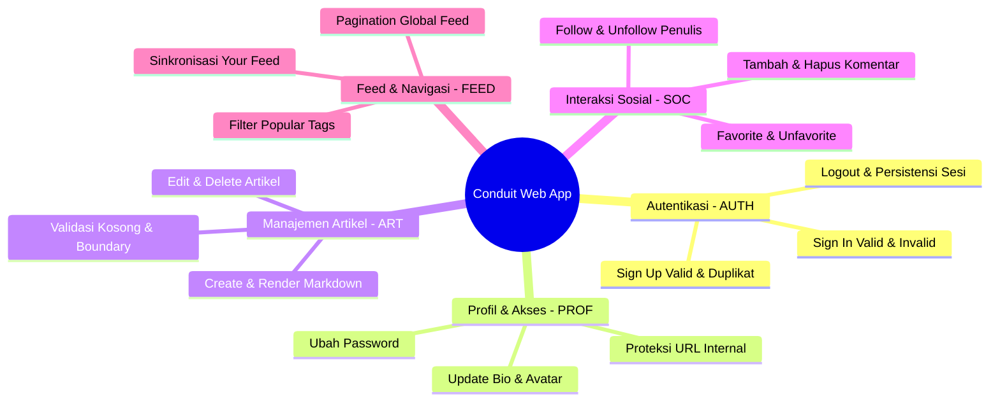

# Master Test Plan — Conduit Web Application

| Atribut Dokumen | Detail |
| :--- | :--- |
| **Document ID** | `TP-CONDUIT-2026-01` |
| **Version** | `1.2 (Final Baseline)` |
| **System Under Test (SUT)** | Conduit Web Application (https://conduit.bondaracademy.com) |
| **Release / Cycle** | Release 1.0 — Core Publishing & Social Engagement Module |
| **Methodology** | Agile / Scrum (Sprint Testing & Regression) |
| **Author / Role** | Manual QA Engineer (Portfolio Case Study) |
| **Toolchain** | TestRail, Jira Software, Postman, MySQL / MariaDB (v26.10), Chrome DevTools, GitHub |

---

## 1. Tujuan Pengujian (Objective)
Dokumen ini menetapkan strategi, ruang lingkup, jadwal, metrik, dan kriteria kualitas untuk pengujian aplikasi web **Conduit**. Tujuan utama pengujian ini adalah memverifikasi bahwa seluruh alur bisnis inti (*authentication, article lifecycle, social interactions,* dan *content feeds*) berfungsi sesuai spesifikasi, bebas dari cacat kritis (*critical defects*), serta mempertahankan konsistensi struktur data antara antarmuka pengguna (UI), layanan REST API, dan model database relasional.

---

## 2. Asumsi Pengujian (Assumptions)
* Pengujian dilakukan pada *environment* publik Conduit yang dapat diakses bebas oleh pengguna lain secara bersamaan.
* Tidak tersedia akses langsung ke *source code* backend maupun database *production*.
* Validasi database dilakukan menggunakan model data relasional yang disimulasikan (*simulated data model*) berdasarkan dokumentasi dan kontrak API publik Conduit.
* Pengujian dilakukan dari perspektif *end-user* menggunakan *browser* desktop.

---

## 3. Ruang Lingkup Pengujian (Scope)

### 3.1 In-Scope (Dalam Ruang Lingkup)
* **Autentikasi & Manajemen Sesi (`AUTH`):** Registrasi pengguna baru, proses *Sign in* dan *Sign out*, validasi kredensial, serta persistensi token autentikasi (JWT).
* **Profil & Kontrol Akses (`PROF`):** Pembaruan informasi bio, tautan avatar, perubahan kata sandi, serta pembatasan akses rute terproteksi (`/settings`, `/editor`) bagi pengguna anonim (*unauthenticated*).
* **Manajemen Artikel (`ART`):** Operasi CRUD (*Create, Read, Update, Delete*) artikel, rendering sintaks Markdown, validasi input wajib, dan pengujian batas karakter (*boundary*).
* **Interaksi Sosial (`SOC`):** Penambahan dan penghapusan komentar, mekanisme *Favorite/Unfavorite* pada artikel, serta fitur *Follow/Unfollow* antar pengguna.
* **Feed & Navigasi (`FEED`):** Pemfilteran konten berdasarkan *Popular Tags*, sinkronisasi lini masa *Your Feed*, tab profil (*My Articles* & *Favorited Articles*), dan navigasi *Pagination*.
* **Integrasi API & Simulasi Validasi Data (`API` & `DB`):** Pengujian kontrak endpoint REST API (status HTTP & struktur *payload* JSON) serta penyusunan kueri MySQL pada model relasional tersimulasi.

### 3.2 Out-of-Scope (Di Luar Ruang Lingkup)
* Pengujian performa beban tinggi (*Load & Stress Testing*).
* Pengujian penetrasi keamanan infrastruktur (*Infrastructure Penetration Testing*).
* Pengujian kompatibilitas perangkat seluler (*Native Mobile App*).

---

## 4. Jenis & Pendekatan Pengujian (Test Types)
1. **Smoke Testing:** Verifikasi cepat terhadap alur kritis (akses halaman, login, pembuatan artikel) sebelum melanjutkan ke pengujian mendalam.
2. **Functional Testing (Black-Box):** Validasi perilaku setiap fitur terhadap ekspektasi bisnis menggunakan skenario *Positive* dan *Negative*.
3. **Boundary Value Analysis (BVA):** Menguji batas ekstrem input, seperti panjang karakter judul artikel ($>250$ karakter) dan panjang minimum kata sandi.
4. **Access Control / Security Testing:** Memastikan rute internal tidak dapat diakses langsung melalui manipulasi URL tanpa sesi login yang sah.
5. **Exploratory & Edge-Case Testing:** Pengujian berbasis intuisi untuk menemukan celah seperti pengiriman ganda (*double-click submit*) atau input karakter spasi kosong.
6. **API Testing:** Validasi langsung terhadap endpoint backend (`POST /users/login`, `GET/POST/PUT/DELETE /articles`, `POST /comments`) menggunakan Postman.
7. **Data Model Validation (Simulated):** Validasi dilakukan menggunakan model relasional MySQL yang merepresentasikan struktur entitas Conduit (`users`, `articles`, `comments`, `favorites`, `follows`) berdasarkan dokumentasi dan kontrak API publik. Tujuannya adalah memvalidasi pemahaman struktur data dan menyusun kueri integritas yang sesuai dengan desain sistem.

---

## 5. Ringkasan Cakupan & Requirement Traceability Matrix (RTM)

### 5.1 Test Coverage Summary per Modul
| Kode Modul | Nama Modul | Positive | Negative | Boundary / Edge / Security | Total Test Cases | Proporsi Modul |
| :--- | :--- | :---: | :---: | :---: | :---: | :---: |
| **`AUTH`** | Autentikasi & Sesi | 3 | 6 | 1 | **10** | 28.6% |
| **`PROF`** | Profil & Kontrol Akses | 2 | 1 | 1 | **4** | 11.4% |
| **`ART`** | Manajemen Artikel (CRUD) | 5 | 3 | 2 | **10** | 28.6% |
| **`SOC`** | Interaksi Sosial | 6 | 1 | 0 | **7** | 20.0% |
| **`FEED`** | Feed & Navigasi | 4 | 0 | 0 | **4** | 11.4% |
| **TOTAL** | **Seluruh Modul** | **20** | **11** | **4** | **35** | **100%** |

### 5.2 Requirement Traceability Matrix (RTM)
| Requirement ID | Deskripsi Kebutuhan Bisnis (User Story) | Mapped Test Case IDs | Coverage |
| :--- | :--- | :--- | :---: |
| **`REQ-01`** | Pengguna dapat mendaftar akun baru, masuk ke sistem, dan mempertahankan sesi login secara aman. | `TC-AUTH-001` s.d. `TC-AUTH-003`, `TC-AUTH-101` s.d. `TC-AUTH-106`, `TC-AUTH-201` | Covered (100%) |
| **`REQ-02`** | Pengguna dapat mengelola profil pribadi serta sistem memblokir akses ilegal ke halaman terproteksi. | `TC-PROF-001`, `TC-PROF-002`, `TC-PROF-101`, `TC-PROF-201` | Covered (100%) |
| **`REQ-03`** | Pengguna terautentikasi dapat membuat, memformat (Markdown), menyunting, dan menghapus artikel. | `TC-ART-001` s.d. `TC-ART-004`, `TC-ART-101` s.d. `TC-ART-103`, `TC-ART-201` s.d. `TC-ART-203` | Covered (100%) |
| **`REQ-04`** | Pengguna dapat berinteraksi melalui komentar, menyukai artikel (*favorite*), dan mengikuti penulis lain. | `TC-SOC-001` s.d. `TC-SOC-006`, `TC-SOC-101` | Covered (100%) |
| **`REQ-05`** | Pengguna dapat menelusuri artikel berdasarkan *tag*, *feed* personal, dan navigasi halaman. | `TC-FEED-001` s.d. `TC-FEED-004` | Covered (90%) |

> **Note:** Beberapa skenario *edge-case* pada modul Feed (seperti kondisi *empty state* pada *Global Feed* atau batas maksimal *pagination* ratusan halaman) belum dapat diverifikasi secara penuh karena keterbatasan kontrol data pada *environment* publik.

---

## 6. Lingkungan, Jadwal & Alur Kerja Pengujian

### 6.1 Test Environment
* **Application URL:** https://conduit.bondaracademy.com
* **Client Browser:** Google Chrome (Versi Stabil Terbaru) — Resolusi Desktop `1920x1080`
* **Test Management:** TestRail (Repositori *Test Case* & Eksekusi *Test Run*)
* **Defect Tracking:** Jira Software (Manajemen Siklus Hidup *Bug*)
* **API & DB Tools:** Postman & MySQL / MariaDB (v26.10) Syntax

### 6.2 Test Schedule
| Phase | Activity | Output / Deliverable |
| :--- | :--- | :--- |
| **Phase 1** | Test Planning | Dokumen `Test_Plan/README.md` dan pemetaan RTM |
| **Phase 2** | Test Case Design | 35 skenario pengujian terstruktur di TestRail |
| **Phase 3** | Smoke Testing | Verifikasi awal alur kritis (akses, registrasi, login) |
| **Phase 4** | Functional & Exploratory Testing | Eksekusi 35 *test case* UI dan pencatatan *bug* di Jira |
| **Phase 5** | API & Data Model Validation | Eksekusi koleksi Postman dan penyusunan kueri MySQL |
| **Phase 6** | Defect Retest | Verifikasi ulang tiket *bug* dan pembaruan status di Jira/TestRail |
| **Phase 7** | Test Closure & Reporting | Publikasi *Test Summary Report* dan arsip portofolio di GitHub |

### 6.3 Agile QA Workflow
1. **Test Design (TestRail):** Menyusun 35 *test case* berdasarkan spesifikasi fitur menggunakan format ID semantik (`TC-[MODUL]-[NOMOR]`).
2. **Smoke & Functional Execution:** Menjalankan *test run* di TestRail sambil memantau tab *Console* dan *Network* pada Chrome DevTools untuk menangkap error HTTP (`4xx`/`5xx`).
3. **Defect Triage & Logging (Jira):** Setiap kegagalan pengujian (*Failed*) dicatat di Jira dengan bukti visual dan langkah reproduksi terstruktur, lalu ditautkan ke hasil eksekusi di TestRail.
4. **API & Data Model Verification:** Menguji endpoint REST API melalui Postman dan menulis kueri validasi integritas data MySQL pada model relasional tersimulasi.
5. **Test Closure & Reporting:** Menyusun ringkasan eksekusi akhir (*Test Summary Report*) dan mengarsipkan seluruh artefak ke GitHub.

---

## 7. Kriteria Masuk & Keluar (Entry & Exit Criteria)

### 7.1 Entry Criteria (Syarat Memulai Pengujian)
* Lingkungan pengujian (https://conduit.bondaracademy.com) aktif dan dapat diakses tanpa error server (`HTTP 502/503`).
* Seluruh 35 *test case* telah terdokumentasi dan ditinjau di dalam repositori TestRail.
* Ruang kerja proyek di Jira dan koleksi *request* dasar di Postman telah siap digunakan.
* Pengujian *Smoke Test* awal pada modul Autentikasi dinyatakan **100% Lulus (Pass)**.

### 7.2 Exit Criteria (Syarat Penghentian / Sign-Off Pengujian)
* **100%** *High Priority Test Cases* telah dieksekusi (*executed*).
* Minimum **95%** dari seluruh *test cases* telah dieksekusi.
* Tidak terdapat *defect* dengan **Severity Critical** atau **Priority P1** yang berstatus `To Do` / *Open*.
* Seluruh *defect* dengan **Severity Major** memiliki keputusan yang terdokumentasi (*Fixed, Accepted Risk,* atau *Deferred*).
* *Test Summary Report* telah dipublikasikan dan ditinjau (*reviewed*).

---

## 8. Klasifikasi Defect & Siklus Hidup Bug

### 8.1 Defect Severity (Tingkat Dampak Teknis — Ditentukan oleh QA)
| Level | Definisi | Contoh Kasus pada Conduit |
| :--- | :--- | :--- |
| **Critical** | Sistem lumpuh total, kehilangan data permanen, atau celah keamanan serius tanpa *workaround*. | Pengguna tidak dapat login/registrasi sama sekali, atau pengguna dapat menghapus artikel milik orang lain. |
| **Major** | Fitur utama tidak berjalan sesuai spesifikasi bisnis dan mengganggu alur pengguna secara signifikan. | Artikel gagal diterbitkan meski seluruh field wajib valid, atau penghitung *Favorite* tidak bertambah. |
| **Minor** | Cacat fungsional ringan atau inkonsistensi UI yang tidak menghambat penyelesaian tugas utama. | Gambar avatar *broken* saat URL tidak valid, atau teks judul panjang meluber keluar kartu artikel. |
| **Trivial** | Masalah kosmetik murni tanpa dampak fungsional. | Kesalahan penulisan (*typo*) pada label tombol atau jarak *padding* elemen sedikit bergeser. |

### 8.2 Defect Priority (Urgensi Perbaikan — Disepakati Tim Produk & Engineering)
| Level | Target Penyelesaian (SLA) | Kriteria |
| :--- | :--- | :--- |
| **P1 — Urgent** | Segera (*Hotfix* / dalam 24 jam) | Memblokir proses pengujian lanjutan atau melumpuhkan fitur utama bagi seluruh pengguna. |
| **P2 — High** | Dalam *Sprint* berjalan | Berdampak pada fungsi bisnis inti, namun masih memiliki solusi alternatif (*workaround*). |
| **P3 — Medium** | *Sprint* berikutnya | Masalah fungsional minor atau validasi *edge-case* dengan frekuensi kejadian rendah. |
| **P4 — Low** | *Backlog* (Jika waktu tersedia) | Masalah kosmetik atau peningkatan pengalaman pengguna (*UI polish*). |

### 8.3 Defect Lifecycle (Jira Workflow)
```text
To Do (Open / Logged)
  ↓
In Progress
  ↓
Ready For Retest
  ↓
Retest
  ↓
Closed
```

**Possible Alternative Status:**
* `Rejected` — Laporan bukan merupakan *bug* (perilaku sesuai spesifikasi sistem).
* `Duplicate` — *Bug* yang sama sudah pernah dilaporkan pada tiket lain.
* `Cannot Reproduce` — Tim *engineering* tidak dapat mereplikasi kendala berdasarkan langkah yang diberikan.
* `Won't Fix` — Cacat terkonfirmasi namun diputuskan tidak diperbaiki karena dampak sangat rendah atau keterbatasan arsitektur.

---

## 9. Test Metrics
Selama proses pengujian berlangsung, metrik berikut dipantau dan dicatat untuk mengevaluasi kualitas rilis:

| Metric | Description |
| :--- | :--- |
| **Total Test Cases** | Jumlah keseluruhan *test case* yang dirancang dalam siklus pengujian (35 *test cases*). |
| **Executed Test Cases** | Jumlah *test case* yang telah dijalankan selama fase eksekusi. |
| **Passed Test Cases** | Jumlah *test case* yang berjalan sesuai *Expected Result* (status `Pass`). |
| **Failed Test Cases** | Jumlah *test case* yang menemukan penyimpangan atau error (status `Fail`). |
| **Blocked Test Cases** | Jumlah *test case* yang tidak dapat dieksekusi akibat kendala prasyarat atau gangguan *environment*. |
| **Pass Rate** | Persentase kelulusan pengujian: `(Passed Test Cases / Executed Test Cases) × 100%`. |
| **Open Defects** | Jumlah tiket *bug* di Jira yang masih berstatus aktif dan belum ditutup (`Closed`). |
| **Defect Density** | Rasio temuan *defect* terhadap total *test case* atau modul yang diuji. |
| **Defect Severity Distribution** | Distribusi jumlah *bug* berdasarkan tingkat keparahan (*Critical, Major, Minor, Trivial*). |
| **Defect Reopen Rate** | Persentase *bug* yang gagal saat *retest* dan harus dibuka kembali (`Reopened`). |

---

## 10. Risiko & Mitigasi (Risks & Mitigation)
| ID Risiko | Deskripsi Risiko | Dampak | Strategi Mitigasi |
| :--- | :--- | :---: | :--- |
| **RSK-01** | **Polusi Data pada Lingkungan Publik:** Karena Conduit adalah *sandbox* publik bersama, data artikel atau akun uji coba dapat diubah/dihapus pengguna lain sewaktu-waktu. | Medium | Menggunakan penamaan akun dan artikel dengan awalan unik (misal: `qa_test_[timestamp]`) serta membuat data uji mandiri di setiap sesi. |
| **RSK-02** | **Keterbatasan Akses Database Langsung:** Tidak tersedia akses langsung ke server database produksi Conduit untuk menjalankan kueri secara *live*. | Low | Merancang model relasional MySQL / MariaDB tersimulasi berdasarkan kontrak API publik (`users`, `articles`, `comments`, `favorites`, `follows`) untuk memvalidasi logika kueri integritas data. |
| **RSK-03** | **Sesi Kedaluwarsa (*Token Expiration*):** Token JWT dapat kedaluwarsa di tengah sesi pengujian eksplorasi yang panjang. | Low | Memantau status kode `401 Unauthorized` pada Chrome DevTools Network dan melakukan autentikasi ulang bila diperlukan. |
| **RSK-04** | **Ketergantungan terhadap Public Environment:** Situs demo publik berada di luar kendali tim QA dan berpotensi mengalami *downtime* atau *reset* mendadak. | High | Menjadwalkan *re-test* dan menyimpan bukti tangkapan layar/log HTTP apabila terjadi *outage* saat *environment* tidak tersedia. |

---

## 11. Artefak Serah Terima & Struktur Repositori

### 11.1 QA Deliverables
1. **Master Test Plan (`Test_Plan/README.md`):** Dokumen perencanaan, asumsi, RTM, metrik, dan manajemen risiko.
2. **Test Case Repository (`Test_Cases/README.md` dan berkas per modul):** 35 skenario pengujian terstruktur.
3. **Test Execution Reports (`Test_Reports/TestRun1_*.pdf` dan `Test_Reports/TestRun2_*.pdf`):** Ekspor hasil eksekusi dari TestRail.
4. **Defect Reports (`Bug_Reports/Jira_Bugs_CON1-CON6.csv`):** Ekspor tiket Jira dengan bukti visual pada `Bug_Reports/evidence/`.
5. **API Test Collection (`API_Testing/Conduit_API_Collection.json`):** Koleksi *request* dan *test assertion* Postman.
6. **SQL Data Validation Scripts (`SQL_Queries/schema_and_seed.sql` dan `SQL_Queries/data_integrity.sql`):** Skema simulasi, seed data, dan kueri audit MySQL.
7. **Test Summary Report (`Test_Reports/README.md`):** Ringkasan eksekutif metrik pengujian dan keputusan rilis.

### 11.2 Repository Structure
```text
/conduit-qa-case-study
├── API_Testing/
├── Bug_Reports/
│   └── evidence/
├── Screenshots/
├── SQL_Queries/
├── Test_Cases/
├── Test_Plan/
├── Test_Reports/
└── README.md
```

---

## 12. Test Coverage Mindmap
